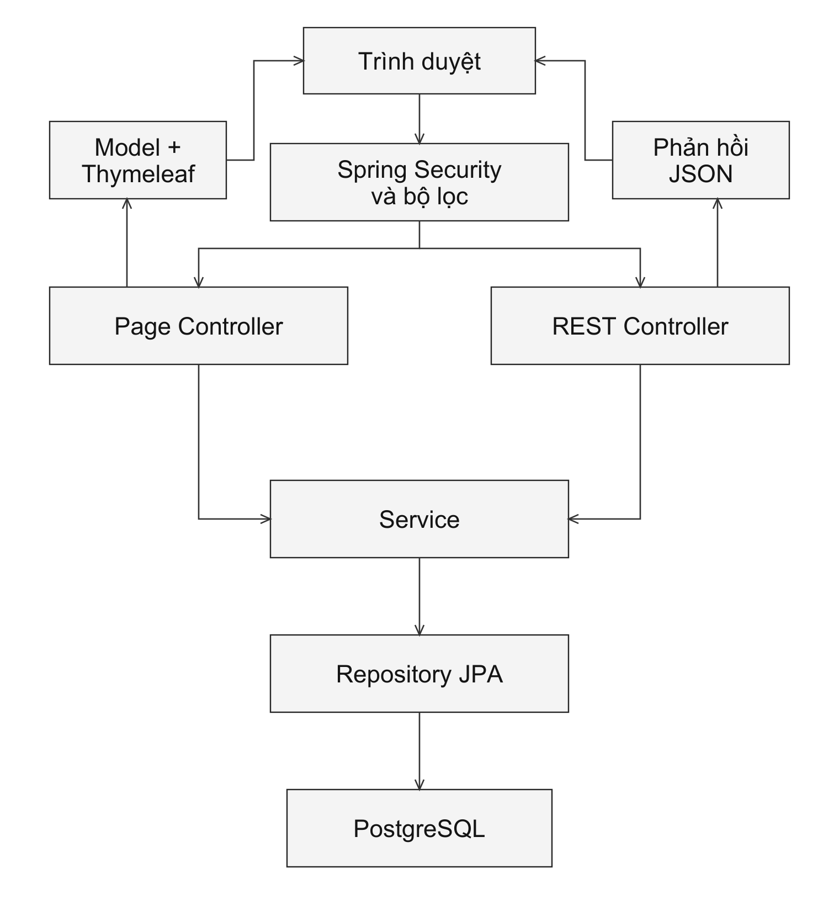

# CHƯƠNG 6: CÀI ĐẶT VÀ KIỂM THỬ

## 6.1. Cài đặt chương trình

Hệ thống LUNEA được xây dựng dưới dạng ứng dụng web phục vụ hoạt động bán mỹ phẩm trực tuyến và quản lý chuỗi cửa hàng. Chương trình được tổ chức theo kiến trúc phân tầng kết hợp mô hình MVC (Model – View – Controller), gồm các thành phần hiển thị giao diện, tiếp nhận yêu cầu, xử lý nghiệp vụ và truy cập dữ liệu. Dữ liệu sản phẩm được quản lý tập trung, trong khi tồn kho được lưu theo từng SKU tại từng cửa hàng. Cách tổ chức này tạo cơ sở để thực hiện các nghiệp vụ đặt hàng, phân công chi nhánh xử lý và theo dõi biến động tồn kho.

### 6.1.1. Các công cụ hỗ trợ

**a) Môi trường lập trình và quản lý mã nguồn**

Dự án sử dụng cấu trúc Maven tiêu chuẩn, có thể mở bằng môi trường phát triển hỗ trợ Java như IntelliJ IDEA hoặc Visual Studio Code. Các công cụ này hỗ trợ quản lý tệp mã nguồn, kiểm tra cú pháp, thực thi chương trình và gỡ lỗi. Các tệp Java đảm nhiệm xử lý phía máy chủ; các tệp HTML, CSS và JavaScript được tổ chức trong thư mục tài nguyên để xây dựng giao diện và xử lý tương tác với người dùng.

Git được sử dụng để quản lý phiên bản mã nguồn, theo dõi thay đổi và hỗ trợ phối hợp giữa các thành viên. Việc lưu lịch sử thay đổi giúp nhóm đối chiếu các phiên bản chương trình, xác định nội dung đã chỉnh sửa và tổ chức công việc theo từng nhóm chức năng.

**b) Công cụ quản lý thư viện và đóng gói chương trình**

Apache Maven quản lý các thư viện phụ thuộc và những bước biên dịch, kiểm thử, đóng gói ứng dụng thông qua tệp `pom.xml`. Dự án cung cấp Maven Wrapper với hai tệp `mvnw` và `mvnw.cmd`, tương ứng cho môi trường macOS/Linux và Windows. Maven Wrapper được cấu hình sử dụng Maven 3.9.16, giúp các máy phát triển thực thi dự án bằng cùng một phiên bản công cụ.

Ứng dụng được cấu hình biên dịch với Java 21. Spring Boot Maven Plugin hỗ trợ khởi chạy trong quá trình phát triển và đóng gói ứng dụng thành tệp JAR có thể thực thi bằng lệnh `java -jar`.

**c) Công cụ thiết lập cơ sở dữ liệu**

Docker Compose được sử dụng để khai báo môi trường PostgreSQL phục vụ phát triển cục bộ. Tệp `docker-compose.yml` định nghĩa dịch vụ `postgres` sử dụng image `postgres:16`, cơ sở dữ liệu có tên `lunea` và container có tên `lunea`. Cổng `5433` trên máy phát triển được ánh xạ đến cổng `5432` trong container. Dữ liệu được lưu trong volume `lunea_pgdata` để duy trì qua các lần dừng và khởi động lại container.

Thông tin kết nối của ứng dụng được khai báo trong `application-local.properties`. Tên đăng nhập và mật khẩu tại hai thuộc tính `spring.datasource.username`, `spring.datasource.password` phải phù hợp với tài khoản PostgreSQL đang sử dụng. Nếu khởi tạo cơ sở dữ liệu từ Docker Compose, các thông tin này cần được đối chiếu với `POSTGRES_USER` và `POSTGRES_PASSWORD` trong tệp cấu hình container.

**d) Trình duyệt và công cụ kiểm tra yêu cầu HTTP**

Trình duyệt được sử dụng để truy cập các trang mua sắm, tài khoản và quản trị của LUNEA. Công cụ dành cho nhà phát triển tích hợp trong trình duyệt hỗ trợ quan sát yêu cầu HTTP, dữ liệu phản hồi, cookie và lỗi JavaScript. Các thông tin này giúp xác định quá trình trao đổi dữ liệu giữa giao diện và máy chủ khi thực hiện những thao tác như đăng nhập, cập nhật giỏ hàng hoặc đặt hàng.

**đ) Thiết lập và khởi chạy ứng dụng**

Để chạy chương trình trong môi trường phát triển cục bộ, máy tính cần có JDK 21 và Docker đang hoạt động. Các lệnh sau được thực hiện tại thư mục gốc dự án:

1. Khởi động dịch vụ cơ sở dữ liệu:

```bash
docker compose up -d postgres
```

2. Kiểm tra cấu hình kết nối trong `src/main/resources/application-local.properties`. Địa chỉ kết nối được sử dụng là `jdbc:postgresql://localhost:5433/lunea`; tài khoản và mật khẩu cần được đồng bộ với cơ sở dữ liệu đã khởi tạo.

3. Khởi chạy ứng dụng với profile `local`:

```bash
./mvnw spring-boot:run -Dspring-boot.run.profiles=local
```

4. Truy cập địa chỉ `http://localhost:8080` để sử dụng chương trình khi không thay đổi cấu hình cổng máy chủ. Trên Windows, sử dụng `mvnw.cmd` thay cho `./mvnw`.

Trong cấu hình local, Hibernate sử dụng `ddl-auto=update` để tạo hoặc cập nhật cấu trúc bảng theo các entity. Lớp `DataSeeder` cung cấp dữ liệu mẫu về vai trò, quyền, tài khoản, cửa hàng, thương hiệu, danh mục, sản phẩm, SKU và tồn kho. Khi các dữ liệu nền đã tồn tại, chương trình chuyển sang nhánh kiểm tra và đồng bộ các tài khoản nhân viên mẫu.

Để tạo gói ứng dụng, thực hiện lệnh `./mvnw package`. Lệnh này bao gồm bước chạy kiểm thử trước khi đóng gói. Khi quá trình build thành công, tệp JAR được tạo trong thư mục `target` và có thể chạy bằng lệnh:

```bash
java -jar target/cosmetic-0.0.1-SNAPSHOT.jar --spring.profiles.active=local
```

### 6.1.2. Giới thiệu sơ lược về các công nghệ được sử dụng trong chương trình

**a) Java và Spring Boot**

Java 21 là ngôn ngữ lập trình chính của hệ thống. Các lớp Java được sử dụng để mô hình hóa dữ liệu, tiếp nhận yêu cầu HTTP, thực hiện nghiệp vụ và trao đổi với cơ sở dữ liệu.

Spring Boot 4.1.1 cung cấp cơ chế khởi tạo và cấu hình ứng dụng, quản lý các thành phần và hỗ trợ chạy máy chủ web nhúng. Chương trình bắt đầu từ phương thức `main` trong lớp `CosmeticStoreChainManagementApplication`. Spring MVC đảm nhiệm việc ánh xạ đường dẫn HTTP đến các phương thức xử lý. Hệ thống phân biệt controller trả về trang giao diện và REST controller trả về dữ liệu JSON, tương ứng với hai cách tương tác của trình duyệt với máy chủ.

**b) Thymeleaf, HTML, CSS và JavaScript**

Thymeleaf được sử dụng để tạo trang HTML từ các template và dữ liệu do controller cung cấp. Những thành phần dùng chung như phần đầu trang, thanh điều hướng, chân trang và thanh chức năng quản trị được tách thành fragment để tái sử dụng giữa các màn hình.

HTML xây dựng cấu trúc nội dung; CSS quy định màu sắc, kiểu chữ, bố cục và cách hiển thị theo kích thước màn hình. JavaScript xử lý các tương tác như chọn SKU, thay đổi số lượng, gửi biểu mẫu và cập nhật nội dung trang. Tệp `static/js/api.js` tập trung các hàm gọi API, định dạng tiền Việt Nam, hiển thị thông báo và cập nhật thông tin giỏ hàng, danh sách yêu thích.

Các yêu cầu trao đổi dữ liệu được gửi bằng Fetch API. Hàm gọi API dùng chung thiết lập header JSON và `X-Requested-With`, đồng thời xử lý các phản hồi lỗi xác thực hoặc quyền truy cập. Giao diện còn sử dụng Bootstrap Icons để hiển thị biểu tượng và GSAP cho một số hiệu ứng chuyển động.

**c) Spring Data JPA, Hibernate và PostgreSQL**

PostgreSQL là hệ quản trị cơ sở dữ liệu quan hệ được cấu hình cho ứng dụng. Trong môi trường local, dự án sử dụng PostgreSQL 16 thông qua Docker Compose. Dữ liệu bao gồm tài khoản, khách hàng, sản phẩm, SKU, cửa hàng, tồn kho, giỏ hàng, đơn hàng và các thông tin vận hành liên quan.

Spring Data JPA cung cấp các repository phục vụ truy vấn và cập nhật dữ liệu. Hibernate thực hiện ánh xạ giữa đối tượng Java và bảng quan hệ dựa trên những khai báo như `@Entity`, `@Table`, `@Column` và `@ManyToOne`. Ví dụ, `InventoryEntity` biểu diễn tồn kho của một SKU tại một cửa hàng, còn `OrderItemEntity` lưu thông tin mặt hàng và giá tại thời điểm đặt.

Các phương thức nghiệp vụ được tổ chức trong service và sử dụng `@Transactional` để xác định phạm vi giao dịch. Cách tổ chức này hỗ trợ phối hợp những thao tác liên quan, chẳng hạn lưu đơn hàng, lưu chi tiết đơn và cập nhật số lượng hàng giữ.

**d) Spring Security, JWT và BCrypt**

Spring Security xử lý xác thực người dùng và kiểm soát quyền truy cập. Người dùng đăng nhập được xác định theo tài khoản khách hàng hoặc nhân viên; các quyền chức năng được sử dụng để kiểm tra khả năng truy cập những nghiệp vụ tương ứng.

Hệ thống sử dụng JWT (JSON Web Token) cho thông tin đăng nhập, với thuật toán ký HS256 và thời hạn mặc định 7.200 giây. Token được đặt trong cookie `LUNEA_AT` có thuộc tính HttpOnly và SameSite=Lax. Cơ chế xác thực cũng hỗ trợ nhận Bearer token từ header `Authorization`. Mật khẩu được băm bằng BCrypt trước khi lưu vào cơ sở dữ liệu.

Phạm vi cửa hàng của nhân viên được xác định thông qua lớp `StoreScope`. Thành phần này được sử dụng trong nghiệp vụ đơn hàng để giới hạn việc truy vấn và xử lý theo các chi nhánh được phân công. Việc kiểm tra quyền chức năng và phạm vi dữ liệu được thực hiện tại các thành phần xử lý phía máy chủ.

**đ) Jakarta Validation, MapStruct và Lombok**

Jakarta Validation hỗ trợ khai báo ràng buộc cho dữ liệu đầu vào. Các DTO sử dụng những annotation như `@NotBlank`, `@NotNull`, `@Size`, `@Min` và `@Pattern` để mô tả yêu cầu về dữ liệu. Chẳng hạn, yêu cầu thêm vào giỏ cần có mã SKU và số lượng từ một trở lên; yêu cầu đăng ký cần có mã OTP gồm sáu chữ số.

MapStruct 1.6.3 hỗ trợ ánh xạ dữ liệu giữa entity và DTO thông qua các mapper. Lombok 1.18.48 hỗ trợ sinh các phương thức thường dùng như getter, setter, constructor và builder. Hai thư viện này giúp giảm phần mã lặp khi khai báo mô hình và chuyển đổi dữ liệu giữa các tầng.

**e) Spring Mail và các công nghệ hỗ trợ kiểm thử**

Spring Mail được sử dụng trong chức năng gửi mã OTP khi đăng ký và khôi phục mật khẩu. Lớp `EmailServiceImpl` xây dựng nội dung thư và gửi thông qua SMTP khi đã có cấu hình máy chủ, tài khoản và thông tin xác thực. Trong môi trường phát triển chưa cấu hình dịch vụ gửi thư, chương trình có nhánh ghi thông tin OTP vào log để phục vụ chạy thử cục bộ.

Hệ thống sử dụng JUnit Jupiter để tổ chức các ca kiểm thử, Mockito để giả lập đối tượng phụ thuộc và MockMvc để kiểm tra yêu cầu HTTP tại tầng controller. H2 được cấu hình làm cơ sở dữ liệu trong bộ nhớ cho các bài kiểm thử tích hợp. Các công nghệ này được trình bày chi tiết cùng các kịch bản và kết quả thực hiện ở phần kiểm thử.

### 6.1.3. Cấu trúc chương trình

**a) Tổ chức mã nguồn**

Mã nguồn chính được đặt trong package `com.thinh.cosmetic`. Các thành phần được phân chia theo trách nhiệm xử lý; bên trong các tầng tiếp tục tổ chức theo nghiệp vụ như tài khoản, sản phẩm, giỏ hàng, đơn hàng, cửa hàng, nhập hàng, trả hàng và đánh giá. Cấu trúc chính của chương trình như sau:

```text
src/
├── main/
│   ├── java/com/thinh/cosmetic/
│   │   ├── CosmeticStoreChainManagementApplication.java
│   │   ├── config/
│   │   ├── controller/
│   │   ├── rest/
│   │   ├── service/
│   │   ├── repository/
│   │   ├── domain/
│   │   │   ├── entity/
│   │   │   ├── dto/
│   │   │   └── enums/
│   │   ├── mapper/
│   │   ├── security/
│   │   └── exception/
│   └── resources/
│       ├── templates/
│       ├── static/
│       └── application*.properties
└── test/
    ├── java/com/thinh/cosmetic/
    └── resources/application.properties
```

*Bảng 6.1. Vai trò của các thành phần trong cấu trúc chương trình*

| Thành phần | Vai trò |
|---|---|
| `config` | Khai báo cấu hình ứng dụng, cấu hình bảo mật và dữ liệu khởi tạo. |
| `controller` | Tiếp nhận yêu cầu truy cập trang, chuẩn bị dữ liệu trong Model và chọn template Thymeleaf. |
| `rest` | Cung cấp các API tiếp nhận dữ liệu và trả phản hồi JSON cho giao diện. |
| `service` | Khai báo interface và lớp triển khai các quy tắc, phép tính, chuyển trạng thái và cập nhật dữ liệu nghiệp vụ. |
| `repository` | Cung cấp các phương thức truy vấn, thêm, cập nhật và xóa dữ liệu qua Spring Data JPA. |
| `domain` | Chứa entity ánh xạ dữ liệu, DTO trao đổi giữa các thành phần và enum quy định trạng thái nghiệp vụ. |
| `mapper` | Chuyển đổi dữ liệu giữa DTO và entity. |
| `security` | Xử lý JWT, cookie, thông tin người dùng đăng nhập, quyền và phạm vi cửa hàng. |
| `exception` | Khai báo lỗi nghiệp vụ và tập trung xử lý phản hồi lỗi cho các yêu cầu API. |
| `templates`, `static` | Chứa giao diện Thymeleaf, CSS, JavaScript, hình ảnh và dữ liệu hỗ trợ phía trình duyệt. |
| `src/test` | Chứa các lớp kiểm thử tự động và cấu hình cơ sở dữ liệu dùng trong kiểm thử. |

Trong tầng service, các interface mô tả chức năng được cung cấp; những lớp trong package `impl` thực hiện nội dung xử lý. Ví dụ, `OrderService` khai báo các thao tác liên quan đến đơn hàng, còn `OrderServiceImpl` thực hiện tính tiền, lựa chọn chi nhánh, giữ tồn, hủy đơn và chuyển trạng thái.

**b) Luồng xử lý yêu cầu**

Khi người dùng truy cập một đường dẫn, yêu cầu đi qua các thành phần bảo mật và bộ lọc trước khi được chuyển đến controller phù hợp. Với yêu cầu tải trang, Page Controller lấy dữ liệu từ service, đưa vào Model và trả tên template. Thymeleaf kết hợp template với dữ liệu để tạo nội dung HTML gửi về trình duyệt.

Với thao tác gửi bằng Fetch API, REST Controller tiếp nhận dữ liệu, thực hiện kiểm tra đầu vào theo khai báo của phương thức và gọi service xử lý. Service áp dụng quy tắc nghiệp vụ, sử dụng repository để truy cập cơ sở dữ liệu và trả kết quả. REST Controller gửi dữ liệu JSON về trình duyệt; JavaScript sử dụng dữ liệu này để cập nhật giao diện hoặc điều hướng đến trang tiếp theo.



*Hình 6.1. Sơ đồ xử lý yêu cầu trong hệ thống LUNEA*

Đối với chức năng đặt hàng, giao diện `checkout.html` gửi yêu cầu đến `OrderRestController`. Controller chuyển dữ liệu cho `OrderServiceImpl` để đọc giỏ hàng, xác định chi nhánh có đủ hàng, tính tổng thanh toán và tạo đơn. Tên sản phẩm, tên biến thể và giá tại thời điểm đặt được lưu trong chi tiết đơn; lượng hàng cần xử lý được ghi nhận bằng reservation và cập nhật vào số lượng đang giữ tại chi nhánh. Sau khi nhận kết quả tạo đơn, giao diện điều hướng đến trang thông báo đặt hàng thành công theo mã đơn.

**c) Tổ chức cấu hình theo môi trường**

Các thuộc tính chung được khai báo trong `application.properties`; cấu hình đặc thù được đặt trong những tệp tương ứng với môi trường sử dụng. Cách phân chia này cho phép thay đổi kết nối dữ liệu và thuộc tính cookie khi chạy ứng dụng mà không phải sửa các lớp xử lý nghiệp vụ.

*Bảng 6.2. Cấu hình theo môi trường sử dụng*

| Môi trường | Tệp cấu hình | Nội dung chính |
|---|---|---|
| Phát triển cục bộ | `application-local.properties` | Kết nối PostgreSQL tại cổng 5433, cập nhật cấu trúc bảng bằng `ddl-auto=update`, cookie có thể sử dụng qua HTTP cục bộ. |
| Triển khai | `application-prod.properties` | Nhận thông tin kết nối từ các biến môi trường `SPRING_DATASOURCE_URL`, `SPRING_DATASOURCE_USERNAME`, `SPRING_DATASOURCE_PASSWORD`; kiểm tra cấu trúc bảng bằng `ddl-auto=validate`; cookie sử dụng thuộc tính Secure. |
| Kiểm thử tự động | `src/test/resources/application.properties` | Sử dụng H2 trong bộ nhớ và `ddl-auto=create-drop` để tạo, hủy cấu trúc dữ liệu theo vòng đời ngữ cảnh kiểm thử. |

Khi sử dụng profile `prod`, cơ sở dữ liệu cần có cấu trúc phù hợp với các entity vì `validate` chỉ kiểm tra cấu trúc hiện có. Kết nối phía người dùng cần được cung cấp qua HTTPS để trình duyệt gửi cookie có thuộc tính Secure. Các cấu hình này xác định điều kiện chạy ứng dụng trong từng môi trường; kết quả vận hành và mức độ đáp ứng nghiệp vụ được đánh giá trong phần kiểm thử.
