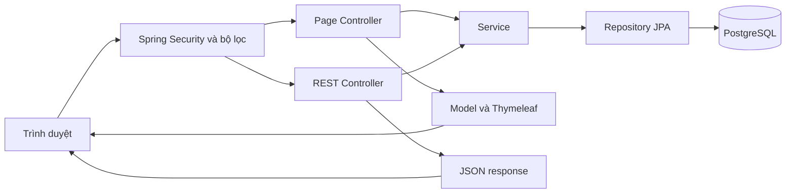

# Kế hoạch viết Chương 6: Cài đặt và kiểm thử — LUNEA

Ngày đối chiếu: **20/10/2026**. Căn cứ vào mã nguồn trong workspace tại thời điểm khảo sát, gồm cả những thay đổi chưa commit; HEAD là `6858efc`.

Đây là **kế hoạch biên soạn chương báo cáo**. Những ca kiểm thử và ảnh minh họa được đề xuất bên dưới chưa phải kết quả kiểm thử thủ công đã thực hiện. Kết quả chạy bộ test tự động hiện có được ghi riêng ở mục 8.

## 1. Phương án đề xuất

Giữ cách tổ chức của Nhóm 17: **6.1. Cài đặt chương trình** và **6.2. Kiểm thử**. Trong 6.1 giữ nguyên ba tiểu mục về công cụ, công nghệ và cấu trúc chương trình. Trong 6.2 giữ ba ví dụ đầu tương ứng với mẫu: đăng nhập, thêm sản phẩm vào giỏ và áp dụng voucher; bổ sung những nghiệp vụ thể hiện đặc trưng chuỗi cửa hàng của LUNEA.

Mượn cách lập kế hoạch kiểm thử của báo cáo Quản lý bãi gửi xe để bổ sung môi trường, dữ liệu, trường hợp ngoại lệ và tiêu chí đánh giá. Các nội dung này được trình bày gọn ở phần mở đầu 6.2 và trong bảng kiểm thử, tránh biến chương thành một tài liệu kế hoạch kiểm thử riêng quá dài.

**Dung lượng dự kiến: 12–16 trang Word**, tùy kích thước ảnh. Phần cài đặt khoảng 3–4 trang; phần kiểm thử khoảng 9–12 trang. Đây là ước lượng biên tập, không phải số trang đã dàn.

### Tài liệu và mã nguồn làm căn cứ

| Nguồn | Nội dung sử dụng |
|---|---|
| [Báo cáo hiện tại của Nhóm 01](Nhom01_BaoCaoCuoiKy_review.pdf) | PDF 204 trang, hiện có nội dung đến Chương 3; đối chiếu 91 use case, quy tắc nghiệp vụ và thiết kế 37 bảng. Các số trang PDF dưới đây tính từ trang đầu tệp. |
| [Báo cáo mẫu Nhóm 17](Nhom17_BaoCaoCuoiKy.docx) | Chương 6, theo mục lục là trang in 109–116: bố cục 6.1/6.2, ba tiểu mục cài đặt, cách mô tả Input – Output – Thực hiện và ảnh minh chứng. |
| [Báo cáo mẫu Quản lý bãi gửi xe](24810046_VoVanTu_24810022_DoBaoAn_TieuLuanCNTT_QuanLyBaiGuiXe.docx) | Phần “Tích hợp và kiểm thử”, đặc biệt “Cài đặt môi trường” và “Kế hoạch kiểm thử”: phạm vi, đối tượng, dữ liệu, phương pháp, tiêu chí đạt/không đạt. |
| [Cấu hình dự án](../pom.xml), [Docker Compose](../docker-compose.yml), cấu hình trong `src/main/resources` | Công nghệ, phiên bản khai báo, môi trường local/prod/test và cách chạy dự án. |
| `src/main/java` | Khảo sát 236 tệp Java chính: controller trang, REST controller, service, repository, entity, DTO, mapper, bảo mật, xử lý lỗi và dữ liệu mẫu. |
| `src/main/resources/templates`, `src/main/resources/static` | Đối chiếu 30 template, JavaScript gọi API, bốn tệp CSS và tài nguyên hỗ trợ với chức năng thực tế trên giao diện. Template bao gồm cả fragment và trang lỗi, không đồng nghĩa 30 màn hình nghiệp vụ. |
| `src/test/java`, `src/test/resources` | 15 tệp Java kiểm thử, 134 phương thức `@Test`; cấu hình H2 và kết quả thực thi bằng Maven. |

README và các tài liệu kiến trúc cũ chỉ dùng để hiểu bối cảnh. Khi có khác biệt, phần mô tả cài đặt phải căn cứ vào mã nguồn hiện tại. Ví dụ README vẫn mô tả repo ở giai đoạn phân tích, còn `DataSeeder` còn thông báo ghi log nhắc SQL Server dù cấu hình hiện tại dùng PostgreSQL.

## 2. Phạm vi có thể đưa vào chương

“Có cài đặt” trong bảng này có nghĩa đã tìm thấy thành phần thực thi tương ứng, không có nghĩa đã kiểm chứng đầy đủ mọi nhánh nghiệp vụ.

| Nhóm chức năng | Hiện trạng tìm thấy | Cách đưa vào Chương 6 |
|---|---|---|
| Đăng nhập, đăng xuất | Spring Security, JWT, cookie `LUNEA_AT`, BCrypt; có giao diện đăng nhập và API | Chọn làm kiểm thử minh họa chính. Mô tả đúng cơ chế JWT, không chép mô tả session của Nhóm 17. |
| Đăng ký, khôi phục mật khẩu | OTP sáu số; các hằng số đặt thời hạn 5 phút, gửi lại sau 30 giây, giới hạn 5 lần sai; có giao diện | Đưa vào bảng kiểm thử bổ sung. Kiểm tra cả luồng HTTP/CSDL; unit test dùng mock chưa đủ kết luận mọi giới hạn hoạt động xuyên suốt. |
| Gửi email OTP | Có `EmailServiceImpl`; gửi SMTP khi được cấu hình, có nhánh ghi log khi chưa cấu hình | Phân biệt thử OTP cục bộ với kiểm chứng nhận email thật. |
| Tra cứu sản phẩm | Có tìm kiếm, lọc thương hiệu/danh mục/loại da/nhu cầu/khoảng giá, sắp xếp và xem chi tiết SKU | Mô tả trong cấu trúc chương trình và bảng kiểm thử bổ sung. |
| Tồn kho theo cửa hàng | Có API xem tồn khả dụng của SKU tại các cửa hàng, hiển thị từ trang chi tiết | Dùng làm điều kiện và minh chứng cho ca đặt hàng. |
| Hồ sơ, địa chỉ, yêu thích | Có service/API và giao diện tương ứng | Đưa vào bảng bao quát phạm vi, không cần mỗi chức năng một mục dài. |
| Beauty Profile | Có entity, service và API lưu/đọc; chưa thấy form sử dụng trong template hồ sơ | Chỉ ghi nhận phần backend hiện có. |
| Gợi ý cá nhân hóa | Sản phẩm liên quan hiện lấy theo cùng danh mục hoặc thương hiệu; chưa thấy đối chiếu Beauty Profile | Không mô tả là đã hoàn thành UC13 hoặc hệ gợi ý cá nhân hóa. |
| Giỏ hàng | Có thêm đúng SKU, gộp số lượng, cập nhật, xóa, kiểm tra tồn và quyền sở hữu | Chọn làm kiểm thử minh họa chính; nhấn mạnh thêm giỏ chưa giữ tồn. |
| Voucher | Ba mã cố định `LUNEA10`, `GIAM50K`, `FREESHIP` trong `OrderServiceImpl`; chưa có module quản lý voucher | Minh họa phạm vi mã mẫu và phép tính. Ghi rõ phần điều kiện voucher đầy đủ chưa được hiện thực. |
| Đặt hàng COD | Có tạo đơn, tính tiền, chọn một cửa hàng đủ toàn bộ hàng, snapshot giá, giữ tồn và xóa giỏ | Chọn làm kiểm thử minh họa chính. |
| Xử lý, hủy đơn | Có máy trạng thái và cập nhật hàng giữ/tồn thực tế; có giao diện khách hàng và quản trị | Chọn làm kiểm thử minh họa chính. |
| Trả hàng, đánh giá | Có kiểm tra đơn hoàn thành/quyền sở hữu; trả hàng cập nhật tồn khi hoàn tất; đánh giá chờ duyệt | Chọn trả hàng để minh họa thêm; đưa đánh giá vào bảng bổ sung. |
| Quản lý sản phẩm | REST/service có thao tác tạo, cập nhật, bật/tắt, xóa theo điều kiện; trang admin hiện chủ yếu tra cứu, lọc, bật/tắt | Phân biệt chức năng có API với chức năng có form thao tác trên web. Chưa thấy API quản lý riêng toàn bộ SKU/thuộc tính/hình ảnh. |
| Quản lý nhân viên | Có tạo/cập nhật, gán vai trò, gán chi nhánh, đồng bộ trạng thái tài khoản và nhân viên | Dùng làm dữ liệu chuẩn bị và minh chứng phân quyền. |
| Nhà cung cấp, nhập hàng, điều chuyển | Có service và REST API; chưa thấy trang quản trị riêng trong bộ template | Đề xuất kiểm thử API ở phụ lục. Không dùng ảnh prototype để khẳng định đã có màn hình hoạt động. |
| Dashboard | Có tổng hợp dữ liệu đơn hàng/tồn thấp ở JavaScript | Chỉ mô tả phạm vi dashboard đang có; chưa có cơ sở gọi là bộ báo cáo đầy đủ UC88–UC91. |
| Nhật ký thao tác | Có entity và repository; chưa thấy luồng ghi/tra cứu nhật ký quản trị | Ghi nhận phần chưa hoàn thiện, không khẳng định đã kiểm thử audit log. |
| Cloudinary, thanh toán trực tuyến, bản đồ | Cloudinary mới có dependency; `PaymentMethod` hiện chỉ có COD; chưa thấy tích hợp bản đồ thực thi | Không liệt kê như các tích hợp đã vận hành. |
| CI/CD, hosting | Chưa thấy workflow build/deploy, Dockerfile ứng dụng hay bằng chứng triển khai trong phạm vi khảo sát | Mô tả chạy local; chỉ bổ sung triển khai thật khi có cấu hình và minh chứng thực tế. |

## 3. Dàn mục chính thức đề xuất

```text
CHƯƠNG 6: CÀI ĐẶT VÀ KIỂM THỬ

6.1. Cài đặt chương trình
    6.1.1. Các công cụ hỗ trợ
    6.1.2. Giới thiệu sơ lược về các công nghệ được sử dụng trong chương trình
    6.1.3. Cấu trúc chương trình

6.2. Kiểm thử
    [Đoạn mở đầu và bảng môi trường/phạm vi kiểm thử]
    6.2.1. Kiểm thử chức năng đăng nhập tài khoản khách hàng
    6.2.2. Kiểm thử chức năng thêm sản phẩm theo SKU vào giỏ hàng
    6.2.3. Kiểm thử chức năng áp dụng mã ưu đãi
    6.2.4. Kiểm thử chức năng đặt hàng và giữ tồn theo chi nhánh
    6.2.5. Kiểm thử xử lý, hủy đơn hàng và cập nhật tồn kho
    6.2.6. Kiểm thử phân quyền theo vai trò và phạm vi chi nhánh
    6.2.7. Kiểm thử yêu cầu trả hàng và nhập lại tồn kho
    6.2.8. Tổng hợp kết quả kiểm thử
```

Ba tiểu mục đầu của 6.2 giữ cách chọn ví dụ của Nhóm 17. Các tiểu mục bổ sung giúp chương phản ánh được mô hình đa chi nhánh thay vì chỉ minh họa quá trình mua sắm.

Nếu cần rút ngắn gần dung lượng mẫu, vẫn giữ ba tiểu mục đầu; gộp 6.2.4–6.2.7 thành bảng kịch bản có ảnh đại diện, rồi điều chỉnh lại số mục. Không cần viết lại toàn bộ 91 đặc tả use case trong chương này.

## 4. Kế hoạch viết phần 6.1

### 4.1. Mục 6.1.1 — Các công cụ hỗ trợ

Viết theo nhóm công việc, mỗi công cụ nêu một đến hai câu về cách sử dụng trong dự án. Phân biệt công cụ đã có bằng chứng cấu hình với công cụ dự kiến dùng để hoàn thiện minh chứng.

| Công cụ | Nội dung cần viết | Căn cứ/việc cần chuẩn bị |
|---|---|---|
| IDE/soạn thảo | Mở dự án, sửa Java và giao diện, chạy/debug ứng dụng | Ghi đúng IDE nhóm thực tế sử dụng. Không tự khẳng định nhóm dùng cả IntelliJ và VS Code chỉ vì mẫu có liệt kê. |
| Git/GitHub | Quản lý thay đổi, nhánh và phối hợp phát triển | Repo Git và tài liệu Git trong `docs`; chỉ mô tả quy trình review/PR nếu nhóm thực tế áp dụng. |
| Maven Wrapper | Quản lý dependency, biên dịch, chạy test, đóng gói JAR | `pom.xml`, `mvnw`, `mvnw.cmd`, `.mvn/wrapper/maven-wrapper.properties`; wrapper khai báo Maven 3.9.16. |
| Docker Compose | Khởi tạo PostgreSQL phục vụ chạy local | `postgres:16`, dịch vụ `postgres`, ánh xạ cổng máy chủ `5433` sang `5432` trong container. Compose hiện chỉ chạy CSDL. |
| Công cụ quản trị PostgreSQL | Xem bảng, quan hệ và dữ liệu trước/sau giao dịch | Dùng công cụ nhóm đã sử dụng, chẳng hạn DBeaver/pgAdmin nếu có; chụp dữ liệu minh chứng thực tế. |
| Trình duyệt và DevTools | Kiểm tra giao diện, request/response, cookie, responsive | Ghi phiên bản trình duyệt tại lần chạy kiểm thử chính thức. |
| Postman hoặc cURL | Kiểm tra API và trường hợp bị chặn quyền | Đây là công cụ đề xuất cho bước thu thập minh chứng; chưa có căn cứ nói nhóm đã hoàn thành collection kiểm thử. |

Đưa quy trình chạy local thành một đoạn ngắn ngay trong 6.1.1 để giữ nguyên bố cục mẫu:

1. Chuẩn bị JDK 21 và Docker hoạt động.
2. Khởi động PostgreSQL: `docker compose up -d postgres`.
3. Chạy ứng dụng: `./mvnw spring-boot:run -Dspring-boot.run.profiles=local`.
4. Truy cập `http://localhost:8080`, kiểm tra dữ liệu khởi tạo và đăng nhập demo.
5. Chạy test: `./mvnw test`. Trên Windows dùng `mvnw.cmd` tương ứng.
6. Sau khi xử lý các test thất bại, dùng `./mvnw package`; gói dự kiến là `target/cosmetic-0.0.1-SNAPSHOT.jar`, chạy bằng `java -jar ... --spring.profiles.active=local`.

Ghi đây là quy trình cần kiểm chứng trên máy chạy demo: lượt khảo sát này đã thực thi bộ test, chưa chạy quy trình Docker + PostgreSQL + trình duyệt từ đầu đến cuối.

Cấu hình local dùng `jdbc:postgresql://localhost:5433/lunea`, `ddl-auto=update`, cookie không yêu cầu HTTPS. Profile prod dùng biến môi trường kết nối CSDL, `ddl-auto=validate`, cookie Secure; vì vậy cần chuẩn bị schema trước khi chạy prod. Chưa có migration/schema triển khai được xác nhận trong repo. Không suy ra đã triển khai Railway chỉ từ dòng chú thích cấu hình.

### 4.2. Mục 6.1.2 — Các công nghệ sử dụng

| Công nghệ | Nội dung trình bày gắn với LUNEA |
|---|---|
| Java 21 | Ngôn ngữ backend, phù hợp `java.version` trong POM. |
| Spring Boot 4.1.1, Spring MVC | Khởi tạo ứng dụng, cấu hình thành phần; tách controller trả trang HTML và REST controller trả JSON. |
| Thymeleaf | Render HTML từ dữ liệu Model, tái sử dụng fragment, hiển thị nội dung theo quyền. |
| HTML, CSS, JavaScript | Giao diện khách hàng/quản trị; Fetch API gọi REST; hỗ trợ bố cục responsive. Nếu nhắc GSAP và Bootstrap Icons, ghi rõ là thư viện giao diện đang được tải từ CDN. |
| Spring Data JPA, Hibernate | Ánh xạ entity, truy vấn qua repository và xử lý giao dịch trong service. |
| PostgreSQL 16 | CSDL local theo Docker Compose. Driver SQL Server có trong POM nhưng không phải cấu hình CSDL đang chọn. |
| Spring Security, JWT, BCrypt | Xác thực, quyền chức năng, cookie HttpOnly `LUNEA_AT`; JWT HS256, thời hạn mặc định 7.200 giây. Không gọi cơ chế chính là đăng nhập bằng HttpSession. |
| Jakarta Validation | Kiểm tra DTO đầu vào; ví dụ số lượng thêm giỏ từ 1, OTP đúng sáu chữ số. |
| MapStruct 1.6.3, Lombok 1.18.48 | Ánh xạ DTO/entity và giảm mã lặp, theo phiên bản khai báo trực tiếp trong POM. |
| Spring Mail | Gửi OTP qua SMTP khi đã cấu hình; tách khỏi việc ghi log OTP trong môi trường phát triển. |
| JUnit Jupiter, Mockito, MockMvc, H2 | Kiểm thử service và HTTP/controller. Dependency được resolve trong lượt chạy này: JUnit Jupiter 6.0.3, Mockito 5.23.0, H2 2.4.240. Không chép phiên bản JUnit 5 của mẫu Nhóm 17. |

Mỗi công nghệ chỉ cần một đoạn ngắn nêu vai trò và ví dụ trong dự án. Không cần trình bày lịch sử framework hoặc quảng bá ưu điểm chung.

### 4.3. Mục 6.1.3 — Cấu trúc chương trình

Chụp cây thư mục từ IDE hoặc trình bày cây rút gọn:

```text
src/main/java/com/thinh/cosmetic/
├── config/             Cấu hình ứng dụng, bảo mật, dữ liệu khởi tạo
├── controller/         Controller trả giao diện Thymeleaf
├── rest/               REST API theo nhóm nghiệp vụ
├── service/            Interface và lớp triển khai nghiệp vụ
├── repository/         Truy cập dữ liệu bằng Spring Data JPA
├── domain/
│   ├── entity/         Các thực thể ánh xạ CSDL
│   ├── dto/            Dữ liệu request/response
│   └── enums/          Trạng thái và tập giá trị nghiệp vụ
├── mapper/             Ánh xạ DTO và entity
├── security/           JWT, cookie, principal, phạm vi cửa hàng
└── exception/          Ngoại lệ và phản hồi lỗi
src/main/resources/
├── templates/          Trang khách hàng, trang admin, fragment, trang lỗi
├── static/             CSS, JavaScript, hình ảnh, dữ liệu địa chỉ
└── application*.properties
src/test/               Kiểm thử tự động và cấu hình H2
```

Giải thích kiến trúc phân tầng kết hợp MVC, tổ chức theo nghiệp vụ. Không gán tên Clean Architecture của báo cáo bãi xe cho cách tổ chức hiện tại.

Mô tả hai luồng xử lý bằng một sơ đồ và một đoạn giải thích:



Chọn luồng đặt hàng làm ví dụ nối các lớp: `checkout.html` → `OrderRestController` → `OrderServiceImpl` → repository đơn hàng/tồn kho → lưu snapshot và giữ tồn → trả mã đơn → `order-success.html`.

Có 39 entity khai báo `@Table` trong source hiện tại. So với thiết kế 37 bảng, có thêm các bảng OTP và bảng thuộc tính cấp sản phẩm, trong khi bảng Voucher chưa có entity thực thi. Khi viết, giải thích chênh lệch thay vì đổi số lượng bảng mà không có đối chiếu.

## 5. Kế hoạch viết phần 6.2

### 5.1. Đoạn mở đầu: mục tiêu, môi trường và phương pháp

Viết khoảng nửa đến một trang, gồm:

- Mục tiêu: kiểm tra hành vi theo use case, phép tính tiền, chuyển trạng thái, quyền truy cập và nhất quán tồn kho.
- Phạm vi: những chức năng đã có thành phần thực thi trong mục 2; chức năng chưa cài đặt ghi rõ là ngoài phạm vi lượt kiểm thử hoặc yêu cầu chưa đáp ứng.
- Môi trường tự động: JDK 21, Maven Wrapper, Spring Boot test, H2 trong bộ nhớ; mock repository ở các unit test service.
- Môi trường chạy tay dự kiến: ứng dụng profile `local`, PostgreSQL 16, trình duyệt và công cụ gọi API. Ghi cấu hình máy và phiên bản trình duyệt sau khi thu thập thật.
- Phương pháp: kiểm thử hộp đen qua giao diện/API; phân vùng hợp lệ/không hợp lệ; giá trị biên cho số lượng, tiền và OTP; kiểm thử đơn vị và tích hợp theo bộ test hiện có.
- Phân biệt bằng chứng: MockMvc không thực thi JavaScript như trình duyệt; unit test với mock không chứng minh giao dịch đồng thời hay PostgreSQL thực tế.

Tiêu chí hoàn tất đề xuất: các ca cốt lõi được thực hiện, kết quả tiền/tồn/quyền đúng yêu cầu đã thống nhất; mọi lỗi thất bại được ghi nhận và thử lại sau sửa. Nếu chưa chạy thì ghi “Chưa thực hiện”; nếu môi trường không cho chạy thì ghi “Bị chặn”. Không dùng tỷ lệ đạt của một số ca để suy ra độ bao phủ toàn bộ source hoặc 91 use case.

### 5.2. Khuôn trình bày chung cho mỗi chức năng

Giữ dạng trình bày của Nhóm 17 và bổ sung bảng đánh giá ngắn:

```text
6.2.x. Kiểm thử chức năng ...
- Mục tiêu và Use Case liên quan:
- Điều kiện trước:
- Input:
- Output mong đợi:
- Thực hiện: các bước đánh số, đường dẫn và thao tác cụ thể.
- Hình 6.x: ảnh thao tác hoặc trạng thái trước khi gửi.
- Hình 6.y: ảnh kết quả sau khi gửi.
- Bảng ca kiểm thử: mã ca, dữ liệu/tình huống, mong đợi,
  kết quả thực tế, đánh giá, minh chứng.
```

“Output mong đợi” là tiêu chí kiểm tra. “Kết quả thực tế” chỉ điền sau thực thi, không sao chép tiêu chí sang cột kết quả.

### 5.3. Nội dung cụ thể từng tiểu mục

| Mục | Nội dung và điều kiện cần chuẩn bị | Kết quả cần quan sát | Nguồn thực thi/kiểm thử |
|---|---|---|---|
| **6.2.1. Đăng nhập** | Tài khoản khách đang hoạt động; vào `/login`; nhập email/SĐT hoặc định danh được hỗ trợ và mật khẩu. Thêm ca sai mật khẩu, bỏ trống, tài khoản ngừng hoạt động. | Đăng nhập hợp lệ chuyển về trang phù hợp, hiển thị tên; cookie JWT được thiết lập. Sai thông tin bị từ chối. Không lấy token thật để đưa vào ảnh báo cáo. | `AuthRestController`, `AccountServiceImpl`, `AppUserDetailsService`, `AuthCookieFactory`; `SecurityAuthorizationTest`, các test tài khoản. Cần chạy tay vì bộ test hiện chưa thay thế luồng đăng nhập đầy đủ trên trình duyệt. |
| **6.2.2. Thêm SKU vào giỏ** | Khách đăng nhập, SKU đang bán và có tồn; vào `/products/{id}`, chọn biến thể và số lượng, thêm giỏ rồi mở `/cart`. | SKU/biến thể và số lượng đúng; thành tiền, badge cập nhật; thêm cùng SKU gộp số lượng; `heldQuantity` chưa tăng. Số lượng vượt tồn hoặc SKU ngừng bán bị chặn. | `product-detail.html`, `api.js`, `CartRestController`, `CartServiceImpl`; một phần `Priority4SynchronizationTest`. |
| **6.2.3. Áp dụng mã ưu đãi** | Giỏ có tổng tiền xác định; vào `/checkout`; lần lượt thử ba mã mẫu và mã không tồn tại. Kiểm tra request preview và đối chiếu lúc tạo đơn. | Công thức và mức giảm khớp bảng bên dưới; giá trị preview, hiển thị và đơn lưu thống nhất. Những điều kiện thời hạn/lượt dùng chưa cài đặt phải được ghi nhận. | `checkout.html`, `OrderRequest`, `OrderServiceImpl.previewOrder/placeOrder`, `OrderServiceTest.testPlaceOrderWithVoucher`. |
| **6.2.4. Đặt hàng và giữ tồn** | Giỏ hợp lệ, địa chỉ hợp lệ, một chi nhánh có đủ mọi SKU. Ghi tồn trước thao tác; xác nhận COD. | Tạo mã đơn, trạng thái `PENDING`, snapshot giá; gán đúng một cửa hàng đủ hàng; tạo reservation `HELD`; tăng hàng giữ và xóa giỏ. Không có cửa hàng đủ toàn bộ đơn thì từ chối. | `OrderServiceImpl`, `OrderEntity`, `OrderItemEntity`, `OrderReservationEntity`; `OrderServiceTest`. |
| **6.2.5. Xử lý/hủy đơn** | Chuẩn bị hai đơn độc lập: một đơn để khách hủy khi `PENDING`, một đơn cho nhân viên xử lý đủ vòng đời. | Khách hủy đơn chờ xác nhận thì giải phóng hàng giữ; chuyển `SHIPPING` thì trừ tồn thực tế và kết chuyển hàng giữ. Chặn bước chuyển trái quy trình; không trừ tồn hai lần khi gửi lại cùng trạng thái. | `OrderStatus`, `OrderServiceImpl`, trang đơn hàng khách/admin; `OrderServiceTest`. |
| **6.2.6. Phân quyền** | Hai khách A/B; `order_hcm`, `order_hn`, `warehouse_hcm`, `admin`; có đơn của cả hai chi nhánh. | Khách không vào được quản trị; thủ kho không vào nghiệp vụ nhân sự; nhân viên đơn HCM không được xem/sửa đơn Hà Nội; khách không xem/sửa dữ liệu của khách khác. Kiểm tra URL/API trực tiếp bên cạnh menu. | `SecurityConfig`, `StoreScope`, `OrderServiceImpl`, controller; `SecurityAuthorizationTest`, `RoleSidebarAndVerificationTest`. |
| **6.2.7. Trả hàng** | Đơn thuộc khách đã `COMPLETED`; có mặt hàng chưa trả hết. Khách gửi yêu cầu ở chi tiết đơn, nhân viên duyệt và hoàn tất nhận trả. | Tạo `REQUESTED`; kiểm tra số lượng không vượt phần được trả; hoàn tất trả tăng tồn ở cửa hàng xử lý; yêu cầu bị từ chối không tăng tồn. Gửi lại trạng thái hoàn tất không tăng hai lần. | `ReturnServiceImpl`, `ReturnStatus`, `account/order-detail.html`, `admin/order-detail.html`; `ReturnServiceTest`. |
| **6.2.8. Tổng hợp** | Tổng hợp ca chạy tay và bộ test tự động thành hai bảng riêng; ghi môi trường, ngày chạy, bản mã nguồn và lỗi còn lại. | Phân biệt đạt/không đạt/chưa thực hiện/bị chặn; kết luận trong phạm vi đã kiểm tra. | Biên bản chạy tay, ảnh, request/response, Maven Surefire. |

#### Bộ dữ liệu tính tiền minh họa cho 6.2.3

Giả sử chuẩn bị hai đơn vị SKU, mỗi đơn vị 200.000 đồng, tổng tiền hàng 400.000 đồng. Đây là **dữ liệu đề xuất**, đồng thời phù hợp fixture của `OrderServiceTest`; không mặc định SKU trong dữ liệu seed có giá này.

| Mã | Giảm tiền hàng | Phí vận chuyển | Tổng thanh toán mong đợi theo logic mã mẫu |
|---|---:|---:|---:|
| Không áp dụng mã | 0 | 30.000 | 430.000 |
| `LUNEA10` | 40.000 | 30.000 | 390.000 |
| `GIAM50K` | 50.000 | 30.000 | 380.000 |
| `FREESHIP` | 0 | 0 | 400.000 |

Thêm ca biên tổng tiền hàng 499.999/500.000/500.001 đồng để kiểm tra mốc miễn phí vận chuyển; giá trị giảm `LUNEA10` bị chặn ở 100.000 đồng. API tạo đơn yêu cầu `paymentMethod: "COD"` theo DTO được kiểm tra bằng `@Valid`. Endpoint preview hiện không gắn `@Valid`, nên có thể nhận payload chỉ gồm `voucherCode` từ giao diện.

#### Bộ dữ liệu tồn kho minh họa cho 6.2.4–6.2.5

Chuẩn bị SKU tại chi nhánh A: tồn thực tế 10, đang giữ 2, khả dụng 8; khách đặt thêm 3.

| Thời điểm | Tồn thực tế | Đang giữ | Khả dụng | Reservation của đơn mới |
|---|---:|---:|---:|---|
| Trước đặt | 10 | 2 | 8 | Chưa có |
| Sau thêm giỏ | 10 | 2 | 8 | Chưa có |
| Sau tạo đơn | 10 | 5 | 5 | `HELD`, số lượng 3 |
| Nhánh hủy khi đang chờ | 10 | 2 | 8 | `RELEASED` |
| Nhánh chuyển đang giao, tính từ sau tạo đơn | 7 | 2 | 5 | `COMMITTED` |

Hai hàng cuối là hai nhánh độc lập; không chạy tiếp bước giao trên đơn đã hủy. Để chứng minh các con số, cần dữ liệu CSDL/API trước và sau; ảnh giao diện đơn hàng riêng lẻ chưa đủ.

## 6. Danh mục ca kiểm thử đề xuất

Danh mục dưới đây phục vụ lập biên bản và chọn ảnh. **Đây là 45 ca đề xuất, không cộng vào 134 test tự động hiện có và chưa đánh dấu tất cả là đã thực thi.**

| Mã | Tình huống cần kiểm tra | Căn cứ/tiêu chí chính |
|---|---|---|
| AUTH-01 | Khách đăng nhập đúng | UC01; trả thông tin và điều hướng phù hợp. |
| AUTH-02 | Sai mật khẩu hoặc tài khoản ngừng hoạt động | Bị từ chối; không tạo đăng nhập thành công. |
| AUTH-03 | Đăng xuất rồi vào lại trang cần đăng nhập | UC02; kiểm tra cookie đã xóa và truy cập bị yêu cầu đăng nhập. Chưa suy ra token đã phát hành bị thu hồi. |
| AUTH-04 | OTP đúng, sai, hết hạn và đã dùng | UC03/UC09; lập từng lượt dữ liệu khi thực thi. |
| AUTH-05 | Gửi OTP trong 30 giây; sai đủ số lần | Kiểm tra giới hạn qua HTTP và CSDL, không chỉ qua mock. |
| CAT-01 | Tìm sản phẩm bằng tên có dấu/không dấu | UC04–UC06; kết quả phù hợp từ khóa. |
| CAT-02 | Kết hợp bộ lọc và sắp xếp giá | UC06; thứ tự, danh mục, thương hiệu và khoảng giá đúng. |
| CAT-03 | Tìm kiếm không có kết quả | Hiển thị trạng thái rỗng phù hợp. |
| CAT-04 | SKU hết hàng hoặc sản phẩm ngừng bán | Kiểm tra danh sách, URL chi tiết trực tiếp và thao tác thêm giỏ. |
| CART-01 | Thêm SKU hợp lệ, thêm lại cùng SKU | UC16; dữ liệu và phép gộp số lượng đúng. |
| CART-02 | Tăng/giảm số lượng và xóa khỏi giỏ | UC17–UC18; thành tiền và tổng tiền cập nhật. |
| CART-03 | Thêm số lượng 0/âm hoặc vượt tồn | Dữ liệu thêm giỏ không hợp lệ phải bị chặn. |
| CART-04 | Thay đổi item giỏ của khách khác | Bị chặn quyền sở hữu. |
| CART-05 | Theo dõi tồn trước/sau thêm giỏ | KH-QĐ7, QLTK-QĐ6; chưa giữ hàng. |
| VCH-01 | Áp dụng từng mã mẫu | UC19–UC20; đối chiếu số tiền trong mục 5.3. |
| VCH-02 | Mã không tồn tại, khoảng trắng, chữ thường | Chuẩn hóa mã và thông báo đúng; không chỉ nhìn toast. |
| VCH-03 | Mốc 500.000 và trần giảm 100.000 | Kiểm tra giá trị biên và phí vận chuyển. |
| VCH-04 | So sánh preview, giao diện và đơn đã lưu | Cùng dữ liệu phải có phép tính nhất quán. |
| ORD-01 | Đặt COD thành công | UC21; lưu đơn, chi tiết, snapshot, reservation và xóa giỏ. |
| ORD-02 | Giỏ rỗng | Từ chối; không tạo đơn hoặc giữ tồn. |
| ORD-03 | Toàn chuỗi đủ hàng nhưng không chi nhánh nào đủ toàn bộ đơn | Từ chối theo quy tắc mỗi đơn một chi nhánh. |
| ORD-04 | Chỉ định cửa hàng thiếu hàng hoặc ngừng hoạt động | Từ chối; không tự gán cửa hàng không đáp ứng. |
| ORD-05 | Sửa giá sản phẩm sau đặt | QLSP-QĐ2; snapshot đơn cũ không đổi. |
| ORD-06 | Hai yêu cầu tranh lượng tồn cuối cùng | Ca bổ sung trên PostgreSQL thật; chỉ kết luận sau đo thực tế. |
| FLOW-01 | Đủ chuỗi PENDING → CONFIRMED → PREPARING → SHIPPING → COMPLETED | UC67/UC69/UC73; trạng thái và mốc thời gian đúng. |
| FLOW-02 | Bỏ bước hoặc quay lại trạng thái trước | Bị chặn theo `OrderStatus.canTransitionTo`. |
| FLOW-03 | Khách hủy đơn PENDING | UC25; hàng giữ được giải phóng. |
| FLOW-04 | Khách hủy đơn CONFIRMED/PREPARING | Ghi nhận chênh lệch giữa đặc tả và source; thống nhất yêu cầu trước khi kết luận. |
| FLOW-05 | Gửi lại trạng thái SHIPPING/COMPLETED | Không khấu trừ tồn thêm lần nữa. |
| SEC-01 | Chưa đăng nhập truy cập trang/API cần xác thực | Kiểm tra redirect với trang và phản hồi lỗi với API. |
| SEC-02 | Khách hoặc nhân viên thiếu quyền vào trang chức năng | Bị chặn cả URL trực tiếp, không chỉ ẩn sidebar. |
| SEC-03 | Nhân viên chi nhánh A xem/sửa đơn chi nhánh B | Danh sách lọc đúng; chi tiết/cập nhật bị chặn. |
| SEC-04 | Truy cập hồ sơ/địa chỉ/đơn của khách khác | Kiểm tra API và `/order-success?orderCode=...` riêng biệt. |
| SEC-05 | Gọi API tồn/nhập/điều chuyển ngoài chi nhánh được giao | Kiểm chứng phạm vi ở backend; menu lọc cửa hàng chưa đủ bằng chứng. |
| RET-01 | Gửi yêu cầu trả từ đơn COMPLETED của chính khách | UC26; lưu yêu cầu và chi tiết đúng. |
| RET-02 | Đơn chưa hoàn thành hoặc thuộc khách khác | Bị từ chối. |
| RET-03 | Tổng lượng trả qua nhiều yêu cầu vượt lượng mua | Bị từ chối; gộp cả các dòng trùng. |
| RET-04 | Duyệt, hoàn tất và gửi lặp hoàn tất | UC63/UC74; nhập tồn đúng một lần tại cửa hàng của đơn. |
| REV-01 | Đánh giá sản phẩm đã mua, sau đó duyệt hiển thị | UC27/UC28/UC37; PENDING chưa công khai, VISIBLE mới hiển thị. |
| REV-02 | Đánh giá trùng hoặc sản phẩm không thuộc đơn | Bị từ chối. |
| INV-01 | Điều chỉnh tồn xuống dưới số đang giữ | UC51; từ chối điều chỉnh làm âm tồn khả dụng. |
| INV-02 | Tồn thực tế 10, giữ 8, ngưỡng 5 | UC56, QLTK-QĐ9; phải xác định tồn thấp theo khả dụng 2. Source truy vấn hiện dùng tồn thực tế, cần ghi nhận chênh lệch. |
| PUR-01 | Xác nhận phiếu nhập rồi xác nhận lại | UC46; tăng tồn một lần, chặn lặp. |
| TRF-01 | Xuất rồi nhận điều chuyển, kho nguồn có hàng giữ | UC53/QLTK-QĐ8; kiểm tra thời điểm cập nhật và không xuất vượt khả dụng. |
| UI-01 | Luồng mua hàng trên desktop/mobile và đo phản hồi | Đánh giá hiển thị; đo mục tiêu khoảng 3 giây trong điều kiện được ghi rõ, không suy ra từ thời gian chạy unit test. |

Khi triển khai AUTH-04/05, VCH-01 và UI-01, tách các bộ dữ liệu trong cùng tình huống thành dòng kết quả riêng nếu cần. Vì vậy số lượt thực thi có thể lớn hơn số mã kịch bản ở bảng.

Các ca về phân quyền tồn kho, cạnh tranh tồn, tồn thấp, điều chuyển và đường dẫn thành công đơn hàng là những điểm cần kiểm chứng thêm từ khảo sát tĩnh. Chưa có kết quả chạy tay để đánh dấu đạt/không đạt cho các ca này.

## 7. Các điểm phải thống nhất trước khi viết kết quả

| Điểm | Đối chiếu hiện tại | Việc cần thực hiện khi biên soạn |
|---|---|---|
| Quy tắc khách hủy đơn | KH-QĐ13 trong PDF trang 26 cho phép trước khi đang giao; `cancelOrder` chỉ nhận `PENDING` | Nhóm chốt quy tắc; đồng bộ yêu cầu hoặc cài đặt trong công việc phát triển tiếp theo. Khi mô tả source hiện tại phải ghi rõ chỉ hủy PENDING. |
| Điều kiện voucher | PDF trang 26 và UC19/UC78 yêu cầu thời hạn, lượt dùng và điều kiện; source chỉ xét ba chuỗi mã | Ghi phạm vi rút gọn và yêu cầu chưa đáp ứng. Không viết đã kiểm thử voucher hết hạn/hết lượt thành công. |
| Mã voucher không hợp lệ ở preview | Endpoint preview không gắn `@Valid`; service không ném lỗi khi mã nằm ngoài ba mã mẫu mà trả phép tính không giảm; UI thông báo áp dụng thành công nếu request trả thành công | Chạy VCH-02 với mã không tồn tại, đối chiếu toast, response và tổng tiền. Có cơ sở từ source để dự kiến thông báo thành công dù không có ưu đãi; chưa có ca chạy trình duyệt xác nhận. Nhánh tính dự phòng tại client chỉ được dùng khi request lỗi. |
| Phạm vi chi nhánh | `StoreScope` được dùng ở nghiệp vụ đơn; nhiều API kho/nhập/điều chuyển kiểm tra quyền chức năng nhưng chưa thấy áp dụng cùng kiểm tra phạm vi | Chạy ca gọi API trực tiếp với chi nhánh khác; không khẳng định toàn hệ thống đã cách ly chi nhánh đầy đủ. |
| Quyền sở hữu đơn trên trang thành công | REST lấy đơn có kiểm tra khách; `CheckoutPageController.orderSuccess` gọi lấy theo mã chưa thấy kiểm tra chủ sở hữu | Thử SEC-04 trên trang này; ghi kết quả riêng, không suy ra an toàn từ test API. |
| Tồn thấp và xuất điều chuyển | Yêu cầu xét tồn khả dụng; `findLowStock` đang so tồn thực tế với ngưỡng, `confirmShipment` kiểm tra tồn thực tế | Thực thi INV-02 và TRF-01 với dữ liệu có hàng giữ; ghi nhận/khắc phục chênh lệch trước khi tuyên bố đáp ứng QLTK-QĐ8/9. |
| Email và OTP | Có SMTP tùy cấu hình, nhánh ghi log và `debugOtp` ở response | Mô tả đúng môi trường phát triển; nhận email thật phải có bằng chứng gửi/nhận riêng. |
| Tính đầy đủ hệ thống | Có entity/dependency chưa đồng nghĩa có quy trình sử dụng hoàn chỉnh | Phân biệt API, UI, dữ liệu mẫu và định hướng; không dùng sơ đồ/mockup thay ảnh chạy thật. |
| Bộ test | Có hai kỳ vọng quyền truy cập không phù hợp cấu hình hiện tại | Rà soát fixture và tiêu chí của hai test; không nới quyền ứng dụng chỉ để ép test xanh. Việc sửa mã/test chưa nằm trong lượt lập kế hoạch này. |

Những điểm này dùng để đảm bảo các chương thống nhất với nhau và kết quả có bằng chứng; không cần đưa toàn bộ bảng vào bản báo cáo cuối nếu nhóm đã xử lý và có bản chạy lại.

## 8. Kết quả bộ test tự động đã chạy khi lập kế hoạch

Chạy ngày **20/10/2026**, với JDK **21.0.10**, Maven Wrapper, lệnh `./mvnw -o test`, dữ liệu H2 theo cấu hình kiểm thử. Lượt chạy đầy đủ cuối kết thúc lúc **19:31:33, giờ Việt Nam**.

| Nhóm/lớp test | Số ca | Đạt | Thất bại |
|---|---:|---:|---:|
| `CosmeticStoreChainManagementApplicationTests` | 1 | 1 | 0 |
| `BrandTests` | 7 | 7 | 0 |
| `OrderEndpointsTest` | 6 | 5 | 1 |
| `Phase1RestEndpointsTest` | 12 | 12 | 0 |
| `RoleSidebarAndVerificationTest` | 8 | 8 | 0 |
| `SecurityAuthorizationTest` | 23 | 23 | 0 |
| `WebPageControllersTest` | 11 | 10 | 1 |
| `AccountServiceTest` | 5 | 5 | 0 |
| `InventoryServiceTest` | 3 | 3 | 0 |
| `OrderServiceTest` | 11 | 11 | 0 |
| `OtpServiceTest` | 13 | 13 | 0 |
| `Priority4SynchronizationTest`, gồm các lớp lồng | 13 | 13 | 0 |
| `ReturnServiceTest` | 8 | 8 | 0 |
| `ReviewServiceTest` | 7 | 7 | 0 |
| `WishListServiceTest` | 6 | 6 | 0 |
| **Tổng** | **134** | **132** | **2** |

Không có error thực thi, không có ca bị bỏ qua trong lượt cuối; Maven kết thúc **BUILD FAILURE** vì hai assertion thất bại. Tỷ lệ đạt là khoảng **98,51% số ca tự động đã chạy**, không phải độ bao phủ source/use case.

Hai ca thất bại:

1. `OrderEndpointsTest.testAdminOrdersPageAccess`, dòng 86: kỳ vọng HTTP 200, thực nhận 403.
2. `WebPageControllersTest.testAdminPagesForEmployee`, dòng 157: kỳ vọng HTTP 200, thực nhận 403.

Cả hai giả lập user có tên `admin` nhưng chỉ gán authority `ROLE_EMPLOYEE`. Cấu hình trang `/admin/orders` hiện yêu cầu `ORDER_VIEW`, `ORDER_PROCESS`, `ROLE_ORDER_STAFF` hoặc `ROLE_ADMIN`. Tên user `admin` trong fixture không tự cấp quyền quản trị. Đây là căn cứ để rà soát kỳ vọng/fixture, không phải kết luận rằng ứng dụng cần cho mọi nhân viên truy cập trang đơn hàng.

Lượt chạy đầu trong sandbox gặp lỗi Java agent của Mockito ở các unit test. Đã chạy lại ngoài sandbox để loại ảnh hưởng môi trường; bảng trên chỉ phản ánh lượt cuối. Không trộn 66 lỗi môi trường của lượt đầu vào kết quả nghiệp vụ.

Báo cáo chi tiết nằm tại `target/surefire-reports/`. Khi nhóm sửa mã và chạy lại, thay số liệu bằng kết quả của bản chốt; không giữ số 132/134 như kết quả cố định của dự án.

## 9. Kế hoạch thu thập ảnh và biên bản

Đánh số hình theo thứ tự xuất hiện của Chương 6. Bảng sau là danh sách dự kiến, chưa có ảnh chạy thật được tạo trong lượt lập kế hoạch.

| Hình dự kiến | Nội dung | Bằng chứng cần nhìn thấy |
|---|---|---|
| 6.1 | Cấu trúc mã nguồn trong IDE | Các lớp chính và thư mục template/static/test. |
| 6.2 | Sơ đồ tổ chức và luồng xử lý | Page Controller/REST → Service → Repository → CSDL. |
| 6.3 | Giao diện đăng nhập | Dữ liệu thử và thao tác gửi; che mật khẩu. |
| 6.4 | Trạng thái sau đăng nhập | Tên khách, thanh điều hướng hoặc trang hồ sơ. |
| 6.5 | Chọn SKU và số lượng | Biến thể cụ thể và trạng thái còn hàng. |
| 6.6 | Giỏ hàng sau khi thêm | Tên SKU/biến thể, số lượng và thành tiền. |
| 6.7 | Áp dụng mã ưu đãi tại checkout | Tiền hàng, mã, mức giảm, phí vận chuyển, tổng tiền. |
| 6.8 | Đặt hàng thành công | Mã đơn, COD, chi nhánh xử lý và tổng tiền. |
| 6.9 | Đối chiếu tồn trước/sau tạo đơn | Tồn thực tế, hàng giữ, khả dụng và reservation. |
| 6.10 | Hủy hoặc cập nhật trạng thái đơn | Mã đơn, trạng thái trước/sau và kết quả thay đổi tồn kèm bảng số liệu. |
| 6.11 | Một thao tác bị từ chối quyền | Tài khoản/vai trò thử, đường dẫn và phản hồi phù hợp. |
| 6.12 | Yêu cầu trả hàng và kết quả xử lý | Mặt hàng, lượng trả, trạng thái và dữ liệu nhập lại kho. |
| 6.13 | Kết quả bộ test tự động bản chốt | Lệnh chạy, tổng số test, failure/error/skip và trạng thái build. |

Ảnh ở các PDF giao diện trong `docs` có thể giúp tham chiếu bố cục, nhưng chỉ dùng làm kết quả kiểm thử khi đã xác nhận là ảnh của bản phần mềm và kịch bản đang báo cáo. Không thay ảnh chạy thật bằng mockup hoặc số liệu dự phòng trong template.

Chuẩn bị một bảng biên bản dùng chung:

| Mã ca | Use Case/quy tắc | Điều kiện và dữ liệu | Các bước | Mong đợi | Thực tế | Đánh giá | Minh chứng |
|---|---|---|---|---|---|---|---|
| … | … | … | … | … | Chưa thực hiện | Chưa thực hiện | … |

Biên bản ghi rõ trình duyệt/CSDL, tài khoản thử, chi nhánh, SKU, mã đơn và ngày thực hiện. Dùng cùng một mã đơn cho ảnh thao tác và dữ liệu đối chiếu.

## 10. Trình tự hoàn thiện chương

| Bước | Công việc | Đầu ra | Ước lượng |
|---|---|---|---|
| 1 | Chốt phạm vi bản demo, quy tắc hủy đơn và mức hỗ trợ voucher; xử lý các chênh lệch cần thiết trong công việc phát triển | Bảng đối chiếu yêu cầu/cài đặt đã thống nhất | 0,5 buổi, chưa tính thời gian sửa chức năng |
| 2 | Chuẩn bị môi trường local, hai khách hàng, các vai trò/chi nhánh và dữ liệu giá/tồn có thể lặp lại | Dữ liệu thử và hướng dẫn chạy được xác nhận | 0,5 buổi |
| 3 | Chạy các kịch bản chính và kiểm tra lỗi; thu ảnh, request/response, dữ liệu trước/sau; chạy lại test bản chốt | Biên bản, ảnh và báo cáo tự động | 1 buổi, có thể tăng nếu phát sinh lỗi |
| 4 | Viết 6.1 theo bảng công nghệ và cây cấu trúc; viết 6.2 theo khuôn Input/Output/Thực hiện | Bản thảo Chương 6 | 1 buổi |
| 5 | Rà soát mã UC, thuật ngữ, số liệu tiền/tồn, trạng thái, hình và giới hạn kết luận | Bản Word đã hiệu đính, cập nhật mục lục/danh mục hình | 0,5 buổi |

Hai thành viên có thể chia một người phụ trách 6.1 và minh chứng cấu hình, một người phụ trách biên bản/ảnh 6.2, sau đó đọc chéo. Đây là đề xuất tổ chức công việc, không phải phân công cá nhân đã được xác nhận.

Sản phẩm cần có khi hoàn tất: một bản Chương 6 theo mục 3, bộ ảnh được đánh số, biên bản ca kiểm thử và kết quả Maven của cùng bản mã nguồn. Phần mô tả giới hạn còn lại phải khớp với Chương 1–3 và phần tổng kết của báo cáo.
